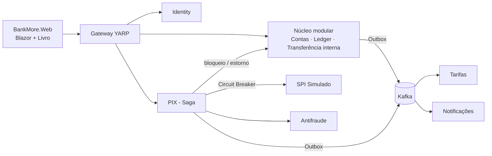

# BankMore — Arquitetura-alvo do laboratório (híbrida)

> Laboratório educacional. Não movimenta dinheiro real.

O BankMore vai ter **as duas arquiteturas na mesma solution**, de propósito:

| Bloco | Estilo | Por quê |
|---|---|---|
| **Núcleo** (Contas, Ledger, Transferência interna) | **Monólito modular** | Compartilha a invariante "dinheiro não é criado nem perdido". Separar exigiria saga para algo que hoje é uma transação ACID ([ADR-001](../adr/ADR-001-arquitetura-hibrida.md)). |
| **Identity** | Microsserviço | Fronteira clara (só emite JWT), muda em ritmo diferente, ninguém faz join com `usuarios`. |
| **Tarifas, Notificações** | Microsserviços (workers) | Nascem FORA do monólito, reagindo a eventos via Outbox + Kafka. Falha neles não pode travar uma transferência. |
| **PIX + SPI Simulado + Antifraude** | Microsserviços | Integração com sistema externo de verdade: aqui a saga e o circuit breaker se justificam. |
| **Gateway** | YARP | Ponto único de entrada e ponto de desvio do Strangler Fig. |

## Mapa da solution (hoje → alvo)

| Hoje | Alvo | Capítulo do livro |
|---|---|---|
| `src/BankMore.Auth.*` (monólito único) | `src/Nucleo/BankMore.Nucleo.*` com módulos Contas e Transferências | 03–05 |
| — | `src/Servicos/Gateway` | 06 |
| login/usuários dentro do monólito | `src/Servicos/Identity` | 07 |
| — | `src/Servicos/Tarifas`, `src/Servicos/Notificacoes` | 08 |
| — | `src/Servicos/SpiSimulado` | 09 |
| — | `src/Servicos/Pix`, `src/Servicos/Antifraude` | 10 |
| — | `src/BuildingBlocks` (Outbox, Observabilidade, Idempotência) | 08, 11 |

Cada pasta de `src/Servicos` tem um README com papel, dados que possui, eventos e critério de pronto.
**Nenhum projeto vazio foi criado**: um `.csproj` sem comportamento só gera ruído e build lento.
Cada serviço nasce no seu capítulo, junto com o teste que prova que ele funciona.
